# ODT-CC: Olympic Digital Twin Command Center

A digital twin command center for the **LA Memorial Coliseum / Exposition Park** venue zone at the LA28 Games.
When 70,000 people leave at the final whistle, ODT-CC forecasts crowd danger **15 minutes ahead** from sensor
data, tests **2,250 operator plans** in about a second, has a self-hosted **NVIDIA Nemotron** model explain the
best options, and applies the plan a human approves to a live **OpenUSD twin in NVIDIA Omniverse**.



## What it does

| Module | Highlights |
|---|---|
| **Scenario planner** (before the event) | Plan inputs: tickets sold, staggered exit, overlapping events, train timetable, road closures. Score any plan SAFE / MARGINAL / UNSAFE and compare plans side by side |
| **Live operations view** | Omniverse twin (crowd density pillars, people still in the bowl, trains, incident beacons), synthetic sensor feeds, alerts, role-based views per agency |
| **Short-horizon forecasting** | XGBoost trained on GPU: 97% of dangers caught with about 15 minutes of warning, with per-zone confidence; works with sensors offline |
| **Incident response** | A world agent causes unscripted incidents (rail failure, crowd from a nearby event, medical, shuttle breakdown, sensor failure); reported ones pause and re-plan, unreported ones are detected from sensor data |
| **Recommendations with human approval** | 3 safe options scored 0–100, a Nemotron briefing with number guardrails, agency-tagged actions, approve / keep / escalate, and a full audit trail |

Normal egress: **99 → 0 dangerous zone-minutes** (peak 6.44 → 0.98 people/m²). The honest trade-off: the
stadium clears at minute 81 instead of 28.

## NVIDIA stack

| | Used for |
|---|---|
| **Omniverse Kit 110** (RTX Real-Time 2.0) + custom `omni.ui` extension | 3D twin and the in-Kit command panel |
| **OpenUSD** | Layered twin: static venue layout + time-sampled crowd layer, rewritten live on every decision |
| **Nemotron 3.5 Lightning 30B-A3B NIM**, self-hosted on one L40S | Tool-calling agent that picks and explains the plan |
| **XGBoost on CUDA** | Forecaster training |
| **cuDF** (`cudf.pandas`) | Optional GPU acceleration of the data scripts |

## Quick start

```bash
python3 -m venv .venv && source .venv/bin/activate
pip install -r requirements.txt --extra-index-url=https://pypi.nvidia.com

scripts/demo_up.sh        # Nemotron NIM (GPU 1) → brain service :8000 → Kit editor + panel (GPU 0)
scripts/warm_caches.sh    # optional: saved cards for the offline fallback
```

Open **http://localhost:8000/dashboard/**, pick a scenario, press **Play**. Details, requirements and the NIM
setup: [docs/USER_GUIDE.md](docs/USER_GUIDE.md).

## Documentation

| Document | Contents |
|---|---|
| [docs/ODT-CC_Solution_Documentation.docx](docs/ODT-CC_Solution_Documentation.docx) (+ [PDF](docs/ODT-CC_Solution_Documentation.pdf)) | Submission document: architecture, workflows, diagrams, screenshots, results (29 pages) |
| [docs/ARCHITECTURE.md](docs/ARCHITECTURE.md) | System design with 14 diagrams: runtime, decision loop, truth vs belief, simulator, forecaster, optimizer, agent guardrails, incidents, modes, USD layers, control surfaces, production path |
| [docs/USER_GUIDE.md](docs/USER_GUIDE.md) | Install, start, operate the dashboard and Kit, scenarios, fallbacks, tests, troubleshooting |
| [docs/API.md](docs/API.md) | Brain service HTTP endpoints |
| [docs/DATA_AND_RESULTS.md](docs/DATA_AND_RESULTS.md) | Assumptions register, measured results, limitations |
| [docs/DEMO_SCRIPT.md](docs/DEMO_SCRIPT.md) | The under-5-minute demo |
| [docs/diagrams/](docs/diagrams/) | All diagrams as SVG |
| [PLAN.md](PLAN.md) | Build log: plan, decisions, test results |
| [docs/overview.md](docs/overview.md) | Early hackathon notes (15 Oct, historical) |

## Repository layout

```
config/venue.json            venue network: zones, areas, capacities, routes
config/scenarios.json        preset scenarios (incidents)
odtcc/                       the brain (Python, .venv)
  generate_data.py           crowd flow simulator (plan phases, incidents, staggered exit)
  scenarios.py               levers, plans, scoring, approval deadline, planning inputs
  sensors.py                 synthetic feeds and density estimates
  predictor.py               15-minute XGBoost forecaster (train / demo)
  optimizer.py               2,250-plan sweep → least effort / most margin / fastest clear
  agent.py                   Nemotron agent, guardrails, action card, fallbacks
  world.py                   world agent: random incidents and follow-up reports
  build_twin.py              OpenUSD twin writer
  server.py                  FastAPI brain service (+ serves the web dashboard)
kit/exts/odtcc.command_center/   Omniverse Kit extension (panel), mock JSON for UI work
web/dashboard/               web dashboard (static HTML/JS/CSS, no build step)
scripts/                     demo_up.sh, warm_caches.sh, launch_editor.sh, nim_smoke_test.py
tests/test_dashboard_e2e.py  end-to-end browser test (Playwright)
usd/                         twin_live.usda (opened in Kit), twin_baseline/plan, layers/
models/                      trained forecaster
data/                        simulation outputs, optimizer and agent caches, audit_log.jsonl
docs/                        documentation and diagrams
```

## Status and limitations

Hackathon build, October 2026. All data is synthetic and the venue is schematic; the forecaster is trained on
the simulator; road traffic is not simulated; egress only (ingress is future work). See
[docs/DATA_AND_RESULTS.md](docs/DATA_AND_RESULTS.md#3-limitations-say-these-out-loud).
