# ODT-CC Architecture

ODT-CC (Olympic Digital Twin Command Center) is a digital twin of the LA Memorial Coliseum / Exposition Park
venue zone for the LA28 Games. It forecasts crowd danger 15 minutes ahead from sensor data, searches for
operator plans that prevent it, explains the best options with a self-hosted Nemotron model, and applies the
plan the operator approves to a live OpenUSD twin in NVIDIA Omniverse.

This document explains how the pieces fit together. For running it, see [USER_GUIDE.md](USER_GUIDE.md); for
the HTTP interface, [API.md](API.md); for numbers and assumptions, [DATA_AND_RESULTS.md](DATA_AND_RESULTS.md).

Contents
1. [System overview](#1-system-overview)
2. [Runtime and deployment](#2-runtime-and-deployment)
3. [The decision loop](#3-the-decision-loop)
4. [Truth, sensors and belief](#4-truth-sensors-and-belief)
5. [The venue model and simulator](#5-the-venue-model-and-simulator)
6. [Forecaster](#6-forecaster)
7. [Optimizer and option scores](#7-optimizer-and-option-scores)
8. [Nemotron agent and guardrails](#8-nemotron-agent-and-guardrails)
9. [Incidents: world agent and detection](#9-incidents-world-agent-and-detection)
10. [Planning mode and operations mode](#10-planning-mode-and-operations-mode)
11. [The OpenUSD twin](#11-the-openusd-twin)
12. [Control surfaces: Kit panel and web dashboard](#12-control-surfaces-kit-panel-and-web-dashboard)
13. [Product modules mapped to code](#13-product-modules-mapped-to-code)
14. [Target production architecture](#14-target-production-architecture)

---

## 1. System overview

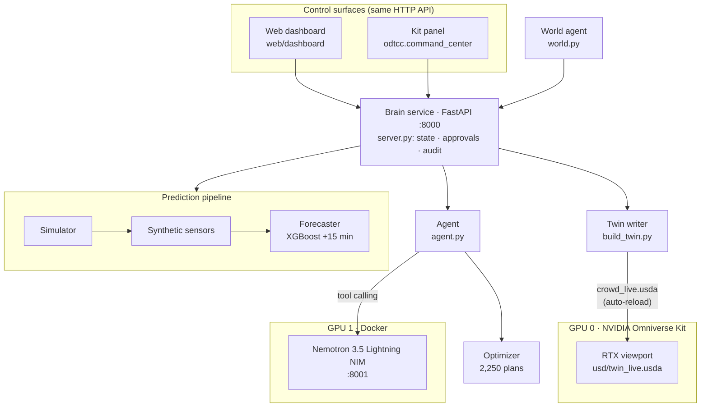

**One brain, two control surfaces, one 3D view.** All computation runs in the Python brain service. The Kit
extension and the web dashboard are thin clients of the same HTTP API, so they always show the same state.
The brain writes the live crowd layer of the OpenUSD twin, and Kit renders it with RTX.

| Component | Code | Technology |
|---|---|---|
| Venue model | `config/venue.json` | 11 nodes: bowl, 4 gates, 2 plazas, station walkway, platform, shuttle stop, parking |
| Crowd simulator | `odtcc/generate_data.py`, `odtcc/scenarios.py` | Minute-by-minute flow network with density cap and back-pressure |
| Synthetic sensors | `odtcc/sensors.py` | Ticket scans, Bluetooth zone counts, gate counters, train departures |
| Forecaster | `odtcc/predictor.py` | XGBoost (trained on CUDA), 15-minute horizon |
| Optimizer | `odtcc/optimizer.py` | Exhaustive sweep of 2,250 lever combinations, parallel on 32 CPU cores |
| Agent | `odtcc/agent.py` | Nemotron 3.5 Lightning 30B-A3B NIM, tool calling, number guardrails |
| World agent | `odtcc/world.py` | Random realistic incidents during a live run |
| Brain service | `odtcc/server.py` | FastAPI on port 8000 |
| Digital twin | `odtcc/build_twin.py`, `usd/` | Layered OpenUSD, rendered in Omniverse Kit 110 (RTX Real-Time 2.0) |
| Kit panel | `kit/exts/odtcc.command_center/` | omni.ui extension |
| Web dashboard | `web/dashboard/` | Static HTML/JS served by the brain service |

---

## 2. Runtime and deployment

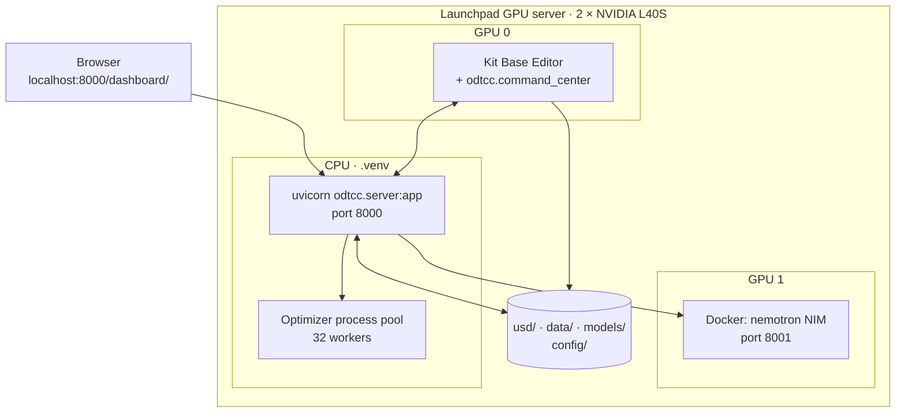

| Process | Start | Port | Log |
|---|---|---|---|
| Nemotron NIM | `docker start nemotron` (or `scripts/demo_up.sh`) | 8001 | `docker logs nemotron` |
| Brain service | `uvicorn odtcc.server:app --port 8000` | 8000 | `~/server.log` |
| Kit editor + panel | `scripts/launch_editor.sh` | – | `~/editor.log` |
| Web dashboard | served by the brain service | 8000 `/dashboard/` | browser console |

`scripts/demo_up.sh` starts all three in order with health checks. Kit is pinned to GPU 0 so the NIM has
GPU 1 to itself.

---

## 3. The decision loop

Every minute of a run follows the same loop: sense, forecast, alert, plan, explain, approve, apply.

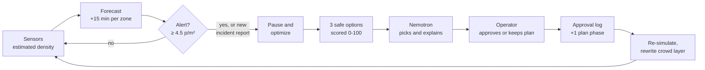

The sequence below is a live run with an unscripted incident, as it happens in the demo.

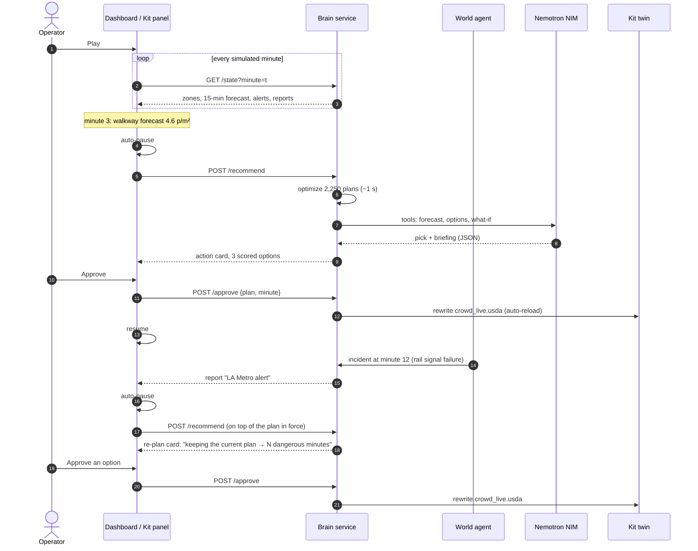

**Approval minute.** A plan takes effect from the minute it is approved, not from minute 0. The simulator keeps
an approval log `[(minute, plan), ...]`; each approval adds a phase. Incidents only act from their own start
minute, so re-simulating with a longer log reproduces every earlier minute exactly (tested: the past is
bit-identical).

---

## 4. Truth, sensors and belief

A real command centre never sees the true crowd. ODT-CC keeps three views apart.

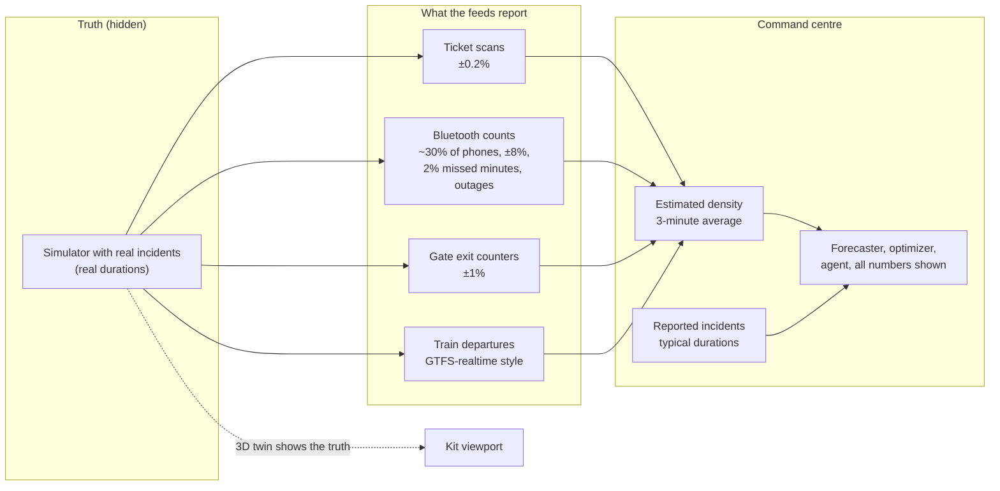

* **Truth** drives the 3D twin and the sensors.
* **Sensor estimates** drive the zone table and the forecaster (which was trained on estimates, with random
  outages, to predict the *true* density).
* **Belief**, the reported incidents with the duration the report gives, drives the optimizer and the agent.
  If an incident lasts longer than reported, follow-up reports ("still not resolved") extend the belief.

---

## 5. The venue model and simulator

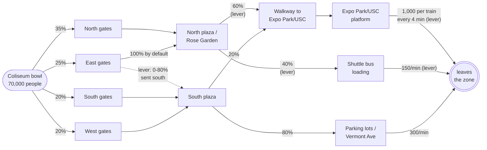

Each minute, each node passes up to its capacity downstream, split by route shares. People can only move into
space that exists: a zone at the physical maximum of 6 people/m² blocks its senders, so queues propagate
backwards like real crowds. Density bands follow Fruin levels of service; **5 people/m² is dangerous** and
the forecaster **alerts at 4.5**. One simulation of 120 minutes takes about 7 ms.

**Operator levers** (with realistic limits) and the agency that carries each out:

| Lever | Default | Range | Owner |
|---|---|---|---|
| Release from the bowl | 2,500/min | 800–2,500 | LA28 Venue Ops |
| Train every | 4 min | 2–4 min | LA Metro |
| Shuttle capacity | 150/min | 150–450 | LA28 Transport / LADOT |
| North plaza to shuttles | 40% | 40–80% | Venue stewards / LAPD |
| East gates to south | 0% | 0–80% | Venue stewards / LAPD |

**Incidents** are part of the venue: `capacity` (a zone's throughput × factor for a window), `inflow` (extra
people per minute, e.g. another event letting out), `sensor_outage` (a zone's counters go dark).
**Planning inputs** change the event itself: tickets sold, a staggered second wave, an overlapping nearby
event, the train timetable, and road closures (expressed through the capacity they remove).

---

## 6. Forecaster

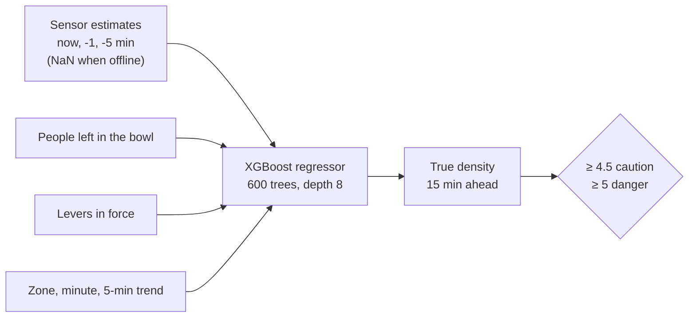

* Trained on CUDA from 600 simulated egress runs: 45–80k attendance, random plans approved mid-run, 30% with a
  random incident, 30% with a random sensor outage. Inputs are sensor estimates; the target is the true
  density. About 33 s.
* Held out: **97% of dangers caught**, 83% of alerts real, average error 0.29 people/m² in busy zones.
* Each forecast carries a **confidence** (high / medium / low from sensor status) and an error band from the
  held-out error.

---

## 7. Optimizer and option scores

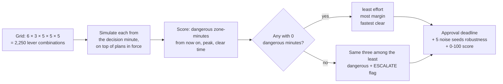

* The sweep runs in about 1.1 s on 32 cores.
* **Option score (0–100), computed by code:** safety 45 (headroom under the danger line, 0 if any dangerous
  minute), clear speed 20, ease 20 (1 − effort/5), time to act 15 (minutes left to approve).
* **Approval deadline:** the last minute at which approving the plan still prevents all danger.

---

## 8. Nemotron agent and guardrails

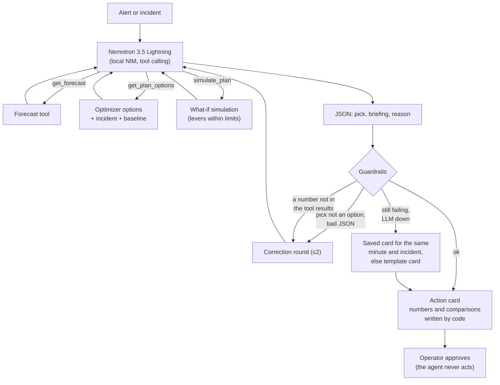

**Division of labour:** Nemotron chooses and explains; code writes every number, comparison, why-bullet and
trade-off. Early versions that let the model compare numbers got them wrong ("4.7 is above 5"), so the model
now only quotes numbers that appear in its tool results, and a checker rejects anything else.

---

## 9. Incidents: world agent and detection

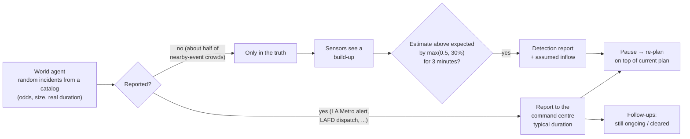

The catalog: E Line signal failure, reduced train service, medical emergency on the walkway, a nearby event
(BMO Stadium, Natural History Museum, California Science Center) letting out, shuttle breakdowns, Bluetooth
sensor failure. Up to 2 incidents between minutes 5 and 45, at least 8 minutes apart; the operator can also
inject one on demand. A twin cannot predict that an incident *starts*; it detects it and simulates its
consequences.

---

## 10. Planning mode and operations mode

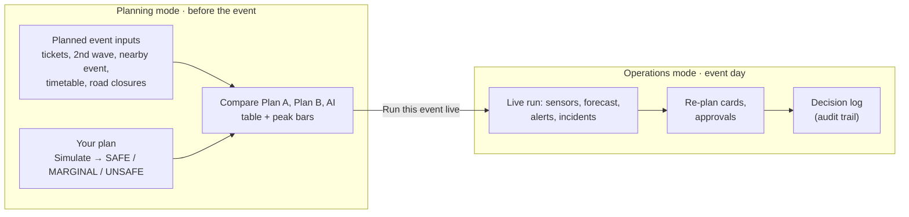

---

## 11. The OpenUSD twin

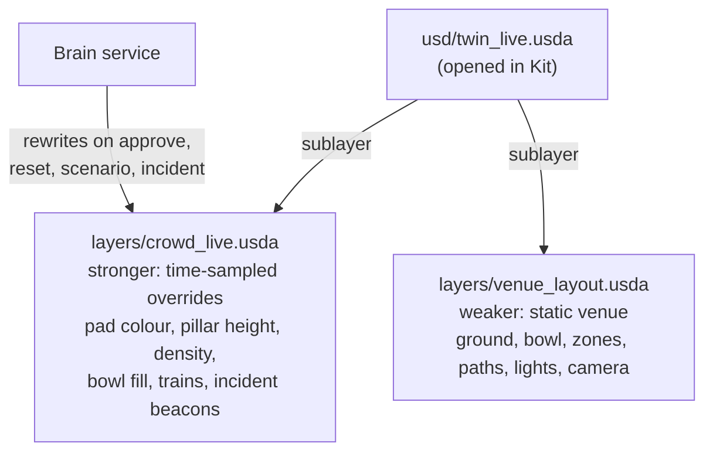

Kit's sublayer auto-reload is switched on by the extension, so a rewritten crowd layer appears in the viewport
without reopening the stage. Visual encoding: pad and pillar colour green → yellow → orange → red by density,
pillar height 10 m per person/m², a blue disc on the bowl for people still inside, a train block at the
platform on each departure, a pulsing red (or amber, for sensors) beacon over an incident zone.

---

## 12. Control surfaces: Kit panel and web dashboard

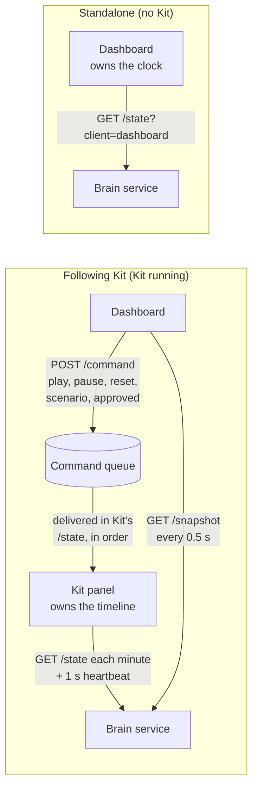

Both surfaces share one recommendation card (`card_id`) and one decision log. Safety rules learned in testing:
commands run strictly in order; a card computed before a reset is marked stale and never shown; after a reset
the panel ignores timeline minutes until Kit has applied minute 0; a new incident always stops the clock.

---

## 13. Product modules mapped to code

| Module | What it does | Where |
|---|---|---|
| 1. Scenario planner | Planned-event inputs, Simulate, compare plans, run the planned event live | `/compare`, `/simulate`, `scenarios.planning_venue`, dashboard Planning column |
| 2. Live operations view | 3D twin, sensor strip, zone table, alerts, incident feed, role-based views | Kit viewport, `/state`, dashboard Operations column |
| 3. Short-horizon forecasting | 15-min forecast from sensors with confidence | `predictor.py`, `sensors.py` |
| 4. Incident response simulator | Incident builder, world agent, detection, re-plan on top of the plan in force | `world.py`, `/incident/inject`, `/scenario custom`, `_detect` |
| 5. Recommendations with human approval | Nemotron card, scored options, approve / keep current, audit trail | `agent.py`, `/recommend`, `/approve`, `data/audit_log.jsonl` |

---

## 14. Target production architecture

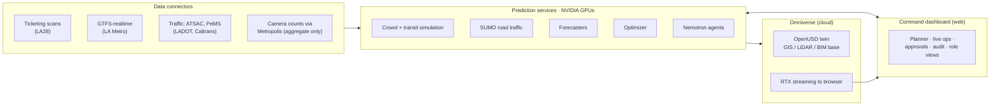

**What runs today vs. the production path:**

| Layer | Running today | Production path |
|---|---|---|
| Data | Synthetic feeds with realistic noise and outages | Ticketing, GTFS-realtime, traffic, aggregate camera counts |
| Simulation | Pedestrian + transit flow network | Plus SUMO road traffic on an OpenStreetMap network |
| 3D | Omniverse Kit on the GPU server | Omniverse in the cloud, streamed to the browser |
| UI | Kit panel + web dashboard (same API) | Web dashboard with role-based access control |

The streaming Kit apps (`my_usd_viewer_streaming`, `my_editor_streaming`) are already built on the server; see
[docs/overview.md](overview.md) for the earlier browser-streaming trial.
